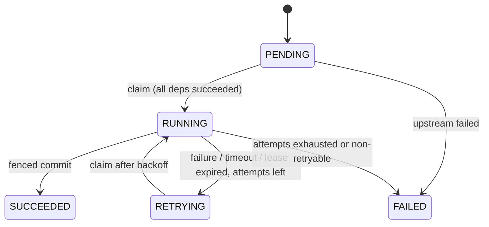
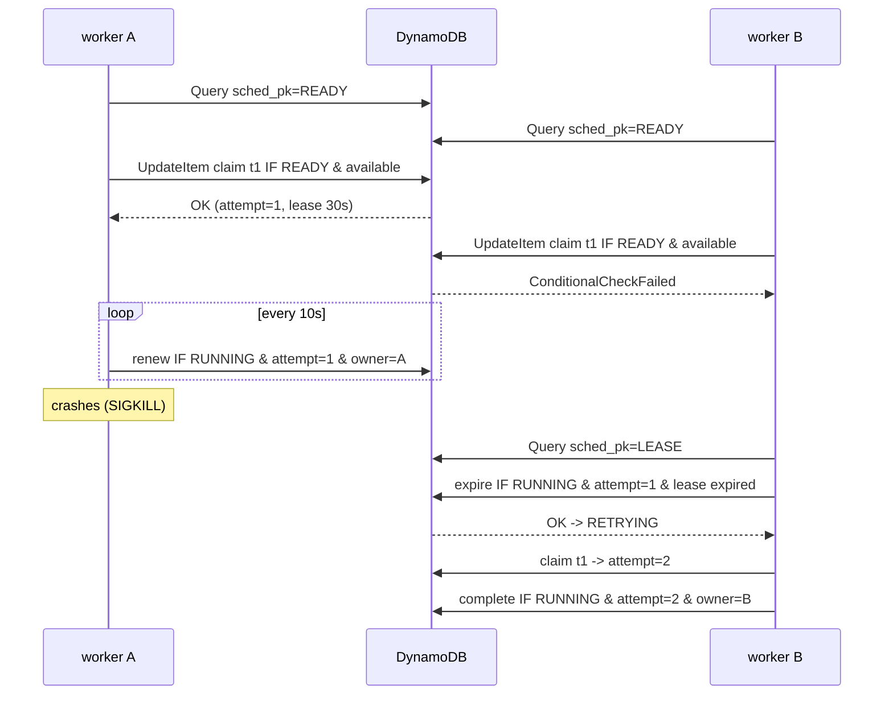

# Flowd

[](https://github.com/depuc8/Flowd/actions/workflows/ci.yml)

Flowd is a distributed workflow scheduler written in C++20. A workflow is a
directed acyclic graph of tasks; Flowd runs each task once all of its
dependencies have succeeded, retries failures with exponential backoff, and
spreads the work over any number of worker processes that coordinate only
through conditional writes to Amazon DynamoDB. Workers can crash at any
moment: expired leases are reclaimed by the survivors, and fencing makes sure
at most one result is ever committed per task.

```text
             flowd submit                        flowd worker  (x N, e.g. one per EC2 instance)
                  |                       +---------------------------------------------+
                  v                       | poller --> lock-free queue --> thread pool  |
   +-----------------------------+  claim |   ^                               |         |
   |  DynamoDB table "flowd"     |<-------+---+   heartbeat (renew leases)    | commit  |
   |   WF#id / TASK#id items     |<-----------------------------------------+         |
   |   sparse GSI "sched":       |  reap expired leases, repair propagation            |
   |   READY# | LEASE# | PROP#   |<---------------- maintenance ------------------------+
   +-----------------------------+
```

- [Features](#features)
- [Quick start](#quick-start)
- [Architecture and system design](#architecture-and-system-design)
- [Workflow definitions](#workflow-definitions)
- [Building](#building)
- [Testing](#testing)
- [Benchmarks](#benchmarks)
- [Running with DynamoDB](#running-with-dynamodb)
- [AWS deployment (EC2)](#aws-deployment-ec2)
- [Using Flowd as a library](#using-flowd-as-a-library)
- [Design trade-offs and limitations](#design-trade-offs-and-limitations)
- [Repository layout](#repository-layout)

## Features

- **DAG execution** with validation (unknown or duplicate dependencies,
  cycles) and dependency tracking that is lock-free in-process and
  idempotent in DynamoDB.
- **Explicit task state machine:** `PENDING -> RUNNING -> RETRYING -> SUCCEEDED / FAILED`.
- **Multithreaded engine:** a thread pool fed by a genuinely lock-free
  Michael-Scott queue with hazard-pointer reclamation.
- **Distributed workers:** atomic claims via DynamoDB conditional writes,
  leases with heartbeats, `(worker, attempt)` fencing tokens.
- **Crash recovery:** any worker reaps expired leases and finishes
  dependency propagation that a crashed worker left half done.
- **Retries:** per-task attempt limits, capped exponential backoff with
  jitter, attempt timeouts, non-retryable failures.
- **Built-in handlers:** `shell` (process-group kill on timeout), `sleep`,
  `echo`, `fail`, `noop`, plus your own C++ handlers.
- **Testable without AWS:** an in-memory store with identical semantics, and
  DynamoDB Local for integration tests.
- **Tooling:** GoogleTest unit and integration tests, ThreadSanitizer,
  AddressSanitizer + UBSan, clang-tidy, cppcheck, GitHub Actions, and
  CloudFormation for EC2.

## Quick start

```bash
cmake --preset release && cmake --build --preset release -j
./build/release/apps/flowd run examples/etl.json
```

```text
TASK                             STATE      ATTEMPT  OUTPUT / ERROR
extract-orders                   SUCCEEDED        1  extracting orders
extract-customers                SUCCEEDED        1  extracting customers
validate                         SUCCEEDED        2  succeeded on attempt 2
transform                        SUCCEEDED        1  transform attempt 1 key=nightly-etl/transform
load-warehouse                   SUCCEEDED        1
refresh-dashboards               SUCCEEDED        1  dashboards refreshed
notify                           SUCCEEDED        1
SUCCEEDED in 0.447s: 7 succeeded, 0 failed
```

`validate` is configured to fail once, so it was retried after its backoff.
`flowd local` runs the same workflow through the full distributed protocol
(claims, leases, fenced commits, propagation) with several workers in one
process:

```bash
./build/release/apps/flowd local examples/failure.json --workers 3
```

```text
TASK                             STATE      ATTEMPT  LEASE OWNER                  LAST ERROR
audit-log                        SUCCEEDED        1
fetch                            SUCCEEDED        1
flaky-api                        FAILED           2                               command failed with exit status 7: upstream unavailable
process                          FAILED           0                               upstream task 'flaky-api' failed
publish                          FAILED           0                               upstream task 'process' failed
status=FAILED total=5 succeeded=2 failed=3 running=0 retrying=0 pending=0
```

## Architecture and system design

The full design (component responsibilities, schema, every conditional
expression, crash-recovery case analysis, memory-ordering arguments) is in
**[docs/ARCHITECTURE.md](docs/ARCHITECTURE.md)**. The essentials:

### Task state machine



`attempt` is incremented by every claim, including claims whose worker later
crashed, so a task that crashes its workers still stops after `max_attempts`.

### DAG execution

- **In-process** (`flowd run`, `DagExecutor`): one atomic "unfinished parents"
  counter per task. The thread whose decrement brings a child to zero is the
  only one that schedules it. A permanent failure fails all descendants with
  CAS (`PENDING -> FAILED`), so concurrent failures never double count.
- **Distributed** (`flowd worker`): each task item holds a `pending` string set
  of unfinished parents. A succeeding parent removes itself with an idempotent
  `DELETE`; the update that empties the set publishes the child's READY
  marker under a condition that makes repeated publication harmless.
  Terminal tasks carry a `needs_prop` flag until their dependents are updated,
  so another worker can finish the job if this one dies midway.

### Distributed workers



### DynamoDB schema

| Key | Value |
|---|---|
| `pk` (partition) | `WF#<workflow_id>` |
| `sk` (sort) | `META` or `TASK#<task_id>` |
| GSI `sched` partition `sched_pk` | `READY#<shard>`, `LEASE#<shard>`, `PROP#<shard>` (sparse; at most one per task) |
| GSI `sched` sort `sched_at` | `available_at`, `lease_expires_at`, `finished_at` |

Task items also hold `state`, `attempt`, `lease_owner`, `lease_expires_at`,
`available_at`, `deps`, `children`, `pending`, `needs_prop`, `handler`,
`payload`, the retry policy, `output` and `last_error`.

### Crash recovery

| Failure | Recovery |
|---|---|
| Worker dies while running a task | Lease expires; any worker's reaper moves it to RETRYING (or FAILED when attempts are exhausted) and it is re-claimed with `attempt + 1`. |
| Worker dies after commit, before updating dependents | `needs_prop` keeps the task in the `PROP#` index; the repairer re-runs the idempotent propagation. |
| Worker is paused or partitioned (zombie) | Its lease is reaped and re-claimed; its late commit fails the `attempt` fence and is discarded. |
| DynamoDB throttling or 5xx | SDK retries with backoff; a failed commit leaves the lease to expire and the task is retried. |

### Delivery semantics

Flowd does **not** claim exactly-once execution. Task bodies run **at least
once** (a crash between "work done" and "commit" means the work is redone),
results are **committed at most once** per task, and each state transition
happens exactly once. Handlers with side effects should be idempotent; they
get a stable `FLOWD_IDEMPOTENCY_KEY` (`workflow/task`) and a monotonically
increasing `FLOWD_ATTEMPT` they can use as a fencing token downstream.

### Concurrency model

A worker runs one poller, one heartbeat, one maintenance thread, and a pool
of executor threads fed by `LockFreeQueue`. The queue is lock-free
(Michael-Scott with helping), linearizable, FIFO per producer, and uses
hazard pointers so nodes are never freed while another thread may read them
(no ABA). Idle executors sleep in `std::atomic::wait` with a protocol that
cannot lose wake-ups. Mutexes are used only off the hot path (timers, the
in-flight map, the in-memory store). See
[ARCHITECTURE.md section 10](docs/ARCHITECTURE.md#10-concurrency-model).

## Workflow definitions

```json
{
  "name": "nightly-etl",
  "defaults": {
    "retry": {"max_attempts": 3, "initial_backoff_ms": 200, "multiplier": 2.0,
              "max_backoff_ms": 5000, "jitter": 0.2},
    "timeout_ms": 60000
  },
  "tasks": [
    {"id": "extract", "handler": "shell", "payload": {"command": "./extract.sh"}},
    {"id": "load", "handler": "shell", "depends_on": ["extract"],
     "retry": {"max_attempts": 5}, "payload": {"command": "./load.sh"}}
  ]
}
```

| Handler | Payload | Behaviour |
|---|---|---|
| `shell` | `{"command": "..."}` | `/bin/sh -c`; non-zero exit is a retryable failure; stdout+stderr captured (64 KiB); process group killed on timeout. Environment: `FLOWD_WORKFLOW_ID`, `FLOWD_TASK_ID`, `FLOWD_ATTEMPT`, `FLOWD_IDEMPOTENCY_KEY`. |
| `sleep` | `{"ms": N}` | Interruptible sleep. |
| `echo` | `{"message": "..."}` | Succeeds with the message as output. |
| `fail` | `{"times": N}` or `{"fatal": true}` | Fails the first N attempts, or fails permanently. |
| `noop` | - | Succeeds immediately. |

Task ids must match `[A-Za-z0-9._-]{1,128}`.

## Building

Requirements: CMake >= 3.25, a C++20 compiler (GCC >= 13 or Clang >= 17), and
Linux. GoogleTest and nlohmann/json are fetched automatically if they are not
installed.

```bash
cmake --preset release            # or debug, clang-debug, tsan, asan
cmake --build --preset release -j
```

DynamoDB support needs the AWS SDK for C++ (core + dynamodb). The bootstrap
script builds it into `./.deps` (and libcurl too, if no development package
is installed):

```bash
scripts/bootstrap-deps.sh                     # ~15 min, once
cmake --preset dynamodb && cmake --build --preset dynamodb -j
```

On Ubuntu, install `libcurl4-openssl-dev libssl-dev zlib1g-dev` first.

| Preset | Purpose |
|---|---|
| `debug`, `release`, `clang-debug` | Normal builds (warnings are errors) |
| `tsan` | ThreadSanitizer (clang) |
| `asan` | AddressSanitizer + UndefinedBehaviorSanitizer (clang) |
| `dynamodb`, `dynamodb-debug` | With `DynamoDbTaskStore` and integration tests |

## Testing

```bash
ctest --preset debug                       # unit tests
ctest --preset tsan                        # same tests under ThreadSanitizer
ctest --preset asan                        # under ASan + UBSan

scripts/dynamodb-local.sh start            # docker/podman, or the Java build
export FLOWD_DYNAMODB_ENDPOINT=http://localhost:8000
ctest --preset dynamodb                    # unit + DynamoDB integration + kill -9 test
```

The store contract suite and the distributed scenarios (crashed worker,
zombie worker, commit failure, interrupted propagation, crash loops, graceful
drain, kill during a claim, 5,000-task runs) are written once and run against both the in-memory
store and DynamoDB Local. `tests/integration/crash_recovery.sh` starts three
real `flowd worker` processes, `SIGKILL`s one while it holds leases, and
checks that the survivors finish the workflow. Results, including
ThreadSanitizer runs, are recorded in **[docs/TESTING.md](docs/TESTING.md)**.

## Benchmarks

```bash
./build/release/benchmarks/flowd_bench          # full suite (~20 s)
./build/release/benchmarks/flowd_bench --quick  # CI-sized
./build/release/benchmarks/flowd_bench --only queue,dag
```

The suite measures queue throughput (lock-free vs. mutex), thread-pool job
rate, DAG scheduling throughput for 1k-100k tasks in three shapes,
concurrent execution of blocking tasks with up to 4,096 threads, and
distributed worker throughput. Measured results and their interpretation
are in **[docs/BENCHMARKS.md](docs/BENCHMARKS.md)**. Highlights on a
16-thread i5-12500H laptop: about 1-2 M no-op tasks/s through the in-process
DAG engine, flat from 1k to 100k tasks, and near-linear scaling of 1 ms
blocking tasks up to 1,024 concurrent threads.

## Running with DynamoDB

Local, without an AWS account:

```bash
scripts/dynamodb-local.sh start
F="./build/dynamodb/apps/flowd"
COMMON="--endpoint http://localhost:8000 --local"

$F init-table $COMMON
$F worker $COMMON --id worker-1 --threads 8 &
$F worker $COMMON --id worker-2 --threads 8 &
ID=$($F submit examples/etl.json $COMMON)
$F status "$ID" --tasks $COMMON
$F submit examples/etl.json $COMMON --wait     # blocks until finished
```

Against AWS, drop `--endpoint` and `--local`. Credentials come from the
standard AWS provider chain (environment, profile, or EC2 instance
profile); Flowd never stores credentials. Options can also be set through
`FLOWD_TABLE`, `AWS_REGION`, `FLOWD_DYNAMODB_ENDPOINT` and `FLOWD_SHARDS`.

| Command | Description |
|---|---|
| `flowd run <wf.json>` | In-process execution. |
| `flowd local <wf.json> [--workers N]` | Distributed protocol with in-process workers and the in-memory store. |
| `flowd init-table` / `delete-table --yes` | Create or delete the table and index. |
| `flowd submit <wf.json> [--id ID] [--wait]` | Persist a workflow. |
| `flowd worker [--threads N] [--lease-ms] [--heartbeat-ms]` | Run a worker until SIGINT/SIGTERM (graceful drain). |
| `flowd status <id> [--tasks]` | Show progress. |

Exit status: 0 success, 1 workflow failed, 2 usage error, 3 runtime error.

## AWS deployment (EC2)

`deploy/ec2/` contains everything needed to run workers on EC2. **Deploying
creates billable resources; nothing in this repository deploys
automatically.**

| File | Purpose |
|---|---|
| `cloudformation.yaml` | DynamoDB table (on-demand, PITR, SSE) with the `sched` index; least-privilege IAM role (table + index, release object, SSM); IMDSv2-only launch template; Auto Scaling group with CPU target tracking. |
| `build-release.sh` | Builds `dist/flowd-<version>-<arch>.tar.gz` (binary + SDK libraries + install files). |
| `install-worker.sh` | Installs the release as the `flowd-worker` systemd service. |
| `flowd-worker.service`, `worker.env.example` | Hardened unit with graceful SIGTERM drain. |
| `deploy.sh` | Uploads the tarball to S3 and deploys the stack. Dry run unless `--yes`. |

```bash
scripts/bootstrap-deps.sh && deploy/ec2/build-release.sh   # build on the target arch (AL2023 arm64 by default)
deploy/ec2/deploy.sh --stack flowd --bucket <artifact-bucket> \
    --tarball dist/flowd-0.1.0-aarch64.tar.gz \
    --vpc vpc-... --subnets subnet-a,subnet-b --region eu-west-1          # prints the plan
deploy/ec2/deploy.sh ... --yes                                             # actually deploys
```

Then submit from anywhere that has DynamoDB access:
`flowd submit wf.json --table flowd --region eu-west-1`. Workers use the
instance profile; there are no keys on the instances. Use Session Manager
instead of SSH. Keep chrony enabled, because leases compare wall-clock time
across instances (see [ARCHITECTURE.md section 11](docs/ARCHITECTURE.md#11-time-and-clocks)).

## Using Flowd as a library

```cpp
#include "flowd/client/workflow_client.hpp"
#include "flowd/store/dynamodb_task_store.hpp"
#include "flowd/worker/worker.hpp"

flowd::HandlerRegistry handlers;
flowd::register_builtin_handlers(handlers);
handlers.add("resize-image", [](const flowd::TaskContext& ctx) {
    // ctx.payload (JSON), ctx.attempt, ctx.idempotency_key(), ctx.stop
    if (ctx.stop.stop_requested()) return flowd::TaskResult::failure("cancelled");
    return flowd::TaskResult::success("done");
});

flowd::AwsSdkSession sdk;
flowd::DynamoDbTaskStore store({.table_name = "flowd", .region = "eu-west-1"});
flowd::Worker worker(store, handlers, {.threads = 16});
worker.start();
// ...
worker.stop();
```

For single-machine use without persistence, `DagExecutor` runs a `Dag`
directly on a `ThreadPool`.

## Design trade-offs and limitations

- **At-least-once execution, not exactly-once.** Handlers must tolerate
  re-execution.
- **Several DynamoDB writes per task** (claim, renewals, commit, one or two per
  dependent). Suited to tasks that take at least milliseconds; use
  `flowd run` for very fine-grained work.
- **Polling-based discovery** with exponential idle backoff (50 ms to 1 s)
  instead of push notifications. That keeps the system free of a coordinator
  at the cost of some latency and read traffic.
- **Eventually consistent index.** Stale candidates cost a failed conditional
  write; correctness relies only on the base table.
- **Bounded clock skew assumed** for lease expiry. Skew can cause duplicate
  executions, never duplicate commits.
- **Submissions above 99 tasks are not atomic.** A crashed submitter can
  leave a workflow that never completes. There is no TTL or GC for finished
  workflows yet.
- **Fixed shard count** per table; no cancellation, priorities or dynamic DAGs.
- **The lock-free queue is not always faster than a mutex queue.** It wins
  under moderate contention and never blocks, but it allocates per element;
  see [docs/BENCHMARKS.md](docs/BENCHMARKS.md).

## Repository layout

```text
include/flowd/   public headers (core, concurrency, engine, store, worker, client)
src/             implementation
apps/flowd/      command line tool
tests/unit/      GoogleTest unit tests
tests/common/    store contract suite and worker scenarios (shared by unit and integration)
tests/integration/  DynamoDB Local tests and multi-process crash test
benchmarks/      flowd_bench
examples/        workflow definitions
deploy/ec2/      CloudFormation, systemd, packaging and deploy scripts
scripts/         dependency bootstrap, DynamoDB Local helper
docs/            architecture, testing and benchmark reports
.github/         CI pipeline
```
