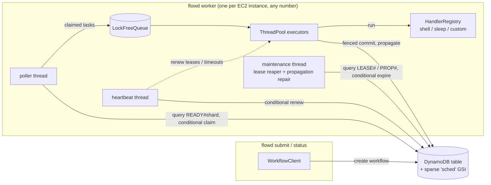
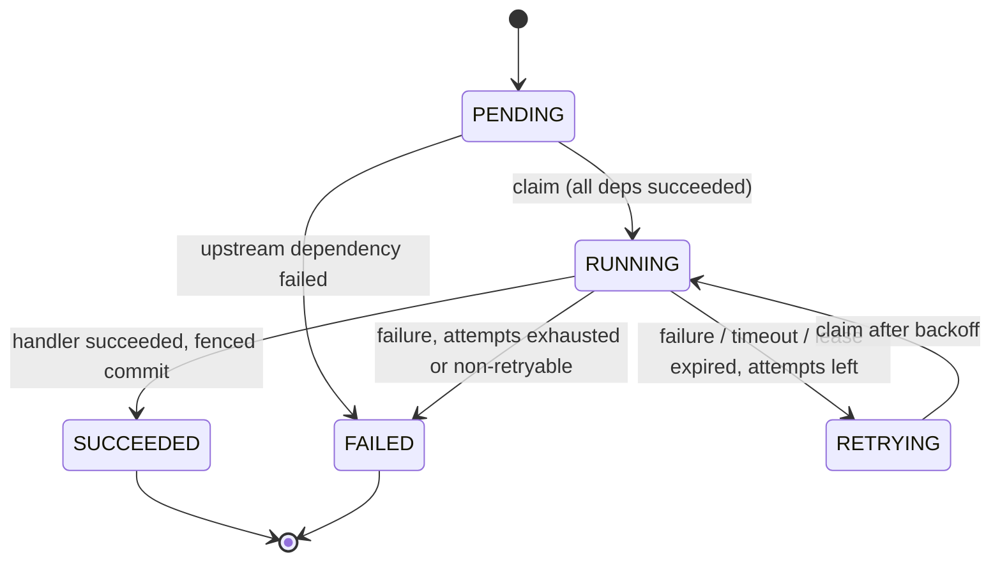

# Flowd architecture

This document describes how Flowd executes DAG workflows, how workers on
different machines coordinate through DynamoDB, what happens when they crash,
and which guarantees the system does and does not give.

- [1. Goals and non-goals](#1-goals-and-non-goals)
- [2. Components](#2-components)
- [3. Task state machine](#3-task-state-machine)
- [4. DAG dependency management](#4-dag-dependency-management)
- [5. Distributed worker coordination](#5-distributed-worker-coordination)
- [6. DynamoDB schema and conditional updates](#6-dynamodb-schema-and-conditional-updates)
- [7. Crash recovery](#7-crash-recovery)
- [8. Delivery semantics and idempotency](#8-delivery-semantics-and-idempotency)
- [9. Retries and backoff](#9-retries-and-backoff)
- [10. Concurrency model](#10-concurrency-model)
- [11. Time and clocks](#11-time-and-clocks)
- [12. Trade-offs and limitations](#12-trade-offs-and-limitations)

## 1. Goals and non-goals

Goals

- Run workflows whose tasks form a directed acyclic graph; a task starts only
  after every dependency succeeded.
- Survive worker crashes at any instruction without losing tasks and without
  a coordinator process: any worker can recover any other worker's work.
- Never commit two results for the same task, even when two attempts of it ran.
- Scale horizontally by adding stateless workers.
- Be testable without an AWS account.

Non-goals

- Exactly-once *execution* of task bodies. That would require the task's side
  effects to take part in a transaction with Flowd's state, which arbitrary
  shell commands cannot do. See [section 8](#8-delivery-semantics-and-idempotency).
- Sub-millisecond distributed scheduling latency. Each distributed state
  transition is one DynamoDB round trip.
- Dynamic DAGs (tasks spawning tasks) and cross-workflow dependencies.

## 2. Components



| Layer | Component | Responsibility |
|---|---|---|
| core | `TaskState`, `is_valid_transition` | The state machine; every store and executor validates against it. |
| core | `RetryPolicy` | Attempt limit and capped exponential backoff with jitter. |
| core | `Dag`, `parse_workflow_json` | Validation (ids, unknown/duplicate deps, cycles), topological order, adjacency. |
| concurrency | `HazardDomain`, `HazardGuard` | Safe memory reclamation for lock-free structures. |
| concurrency | `LockFreeQueue<T>` | Michael-Scott MPMC queue, the thread pool's work queue. |
| concurrency | `ThreadPool` | Fixed worker threads, lock-free submit, futex-based idle sleep. |
| engine | `HandlerRegistry`, built-in handlers | Maps handler names to code; `shell` runs commands with timeouts. |
| engine | `TimerService` | Delayed callbacks for retry backoff and attempt timeouts. |
| engine | `DagExecutor` | In-process DAG execution (`flowd run`), no persistence. |
| store | `TaskStore` | Persistence and coordination contract (conditional transitions). |
| store | `InMemoryTaskStore` | Reference implementation; used by unit tests and `flowd local`. |
| store | `DynamoDbTaskStore` | Production implementation on one DynamoDB table. |
| worker | `Worker` | Claims, executes, heartbeats, reaps and propagates. |
| client | `WorkflowClient` | Submission, status, waiting. |

There is deliberately no scheduler or leader process. DynamoDB conditional
writes serialize all decisions, so every worker is equal and any of them can
be killed at any time.

There are two execution paths that share the core and the thread pool:

1. **In-process** (`DagExecutor`): dependency counters in memory, for single
   machine runs and for the engine benchmarks.
2. **Distributed** (`Worker` + `TaskStore`): all state lives in the store, so
   it survives process crashes and is shared across machines.

## 3. Task state machine



`is_valid_transition()` (`include/flowd/core/task_state.hpp`) is the single
definition of these edges; a unit test checks the full 5x5 matrix. Notes:

- `attempt` counts started attempts and is incremented by the claim, so an
  attempt that crashed still counts against `max_attempts`. A task that kills
  every worker that runs it therefore fails after `max_attempts` crashes
  instead of looping forever.
- An expired lease is treated as a failed attempt (`RUNNING -> RETRYING` or
  `RUNNING -> FAILED`), not as an implicit re-claim. That keeps one code path
  for "the attempt did not finish" and makes the attempt limit apply to crashes.
- `PENDING -> FAILED` happens only through failure propagation; a task whose
  ancestor failed can never become runnable.

## 4. DAG dependency management

**Validation** (`Dag` constructor): non-empty, unique ids matching
`[A-Za-z0-9._-]{1,128}`, every dependency exists, no self or duplicate
dependencies, valid retry settings, and no cycles. Cycle detection is Kahn's
algorithm: any task that never reaches in-degree zero lies on or behind a
cycle, and the error message names the involved tasks. Validation happens
before anything is persisted.

**In-process execution.** Each task has an atomic counter of unfinished
parents. A succeeding task decrements its children's counters with
`fetch_sub(acq_rel)`; the thread whose decrement returns 1 is the *only*
thread that schedules the child. No lock is needed, and a child is never
scheduled twice. A permanently failed task walks its descendants and moves
each from PENDING to FAILED with a CAS; losing the CAS means another failing
path already owns that subtree, so concurrent failures along different paths
fail each task exactly once. Completion is detected with one terminal counter.

**Distributed execution.** Each task record stores its immutable `depends_on`
and `children` lists plus a shrinking `pending_deps` set:

1. When a task commits SUCCEEDED, the committing worker calls
   `resolve_dependency(child, parent)` for every child. In DynamoDB that is
   `DELETE pending :parent` on a string set, which is idempotent.
2. If the set became empty and the child is PENDING, a second conditional
   update publishes the child's READY marker
   (`attribute_not_exists(pending) AND attribute_not_exists(sched_pk) AND state = PENDING`),
   so even concurrent or repeated publication releases the child once.
3. Finally the parent's `needs_prop` flag is cleared.

If the worker crashes anywhere in steps 1-3, `needs_prop` is still set and the
parent stays in the `PROP#` index; any worker's maintenance loop re-runs the
(idempotent) propagation after `propagation_grace`. Failure propagation works
the same way with `fail_upstream` (PENDING -> FAILED), recursively for newly
failed tasks, each of which carries its own `needs_prop` flag.

## 5. Distributed worker coordination

### Claiming

The poller queries the sparse index for claimable tasks of one shard
(`sched_pk = READY#<shard> AND sched_at <= now`), shuffles the candidates to
reduce collisions with other workers, and claims each with one conditional
update:

```text
SET   state = RUNNING, attempt = attempt + 1, lease_owner = :worker,
      lease_expires_at = :now + lease, sched_pk = LEASE#<shard>, sched_at = :exp
IF    begins_with(sched_pk, "READY#") AND available_at <= :now
      AND state IN (PENDING, RETRYING)
```

The index is eventually consistent, so candidates may be stale (already
claimed, still backing off). That is harmless: the condition is evaluated on
the strongly consistent base item, exactly one claimant wins, and the losers
count a `claim_conflict` and move on. Workers start at a random shard and
rotate, so they spread over the index partitions.

The number of claimed-but-unfinished tasks is bounded by `max_in_flight`
(default: number of executor threads), because a claimed task's lease runs
even while it waits for a thread.

### Leases, heartbeats and fencing

A claim grants a lease until `lease_expires_at`. The heartbeat thread renews
leases of in-flight tasks every `heartbeat_interval` with:

```text
SET lease_expires_at = :exp   IF state = RUNNING AND attempt = :a AND lease_owner = :worker
```

`(lease_owner, attempt)` is the fencing token. Every write a worker makes for
an attempt (renew, complete, fail) carries it, so once a task was reaped and
re-claimed (which increments `attempt`), the previous owner's writes fail
their condition, no matter how late they arrive. When a renewal is rejected
the worker cancels the attempt through its `stop_token` and discards its
result.

Completion does not require the lease to be unexpired: if the attempt finishes
after its lease expired but before anyone reaped it, the result is still
accepted, because the task is still owned by that attempt. Whichever of
"complete" and "expire" reaches DynamoDB first wins; the other fails its
condition.

### Lease reaper

Every `maintenance_interval` each worker queries `LEASE#<shard>` for leases
that expired before now and moves them on with:

```text
IF state = RUNNING AND attempt = :a AND lease_expires_at < :now
```

The new state is RETRYING (with backoff) or FAILED (attempts exhausted),
decided from the record the reaper read; because the condition pins `attempt`,
a decision based on a stale read can never be applied. Reaping is redundant
across workers by design; only one reaper wins per lease.

### Timeouts

`timeout_ms` is enforced by the heartbeat thread: past the deadline it
requests stop on the attempt's `stop_token`. The `shell` handler kills the
command's whole process group; the result is recorded as a retryable
"timed out" failure.

### Graceful shutdown

`SIGTERM` stops claiming, waits up to `--drain-timeout-ms` for in-flight
attempts (heartbeats continue meanwhile), cancels the rest, commits their
outcomes and exits. `SIGKILL` is handled by the lease reaper instead.

## 6. DynamoDB schema and conditional updates

Single table (default name `flowd`), on-demand capacity.

| Attribute | Type | Meaning |
|---|---|---|
| `pk` | S, partition key | `WF#<workflow_id>` |
| `sk` | S, sort key | `META` for the workflow item, `TASK#<task_id>` for tasks |
| `sched_pk` | S, GSI partition key | `READY#<shard>`, `LEASE#<shard>` or `PROP#<shard>`; absent otherwise |
| `sched_at` | N, GSI sort key | `available_at`, `lease_expires_at` or `finished_at` (ms since epoch) |
| `state` | S | `PENDING`, `RUNNING`, `RETRYING`, `SUCCEEDED`, `FAILED` |
| `attempt` | N | attempts started (fencing token) |
| `lease_owner`, `lease_expires_at` | S, N | present only while RUNNING |
| `available_at` | N | earliest claim time (retry backoff) |
| `deps`, `children` | SS | immutable graph edges (absent when empty) |
| `pending` | SS | parents not yet succeeded (absent when empty) |
| `needs_prop` | BOOL | terminal, dependents not yet updated |
| `handler`, `payload`, `timeout_ms` | S, S, N | what to run |
| `max_attempts`, `backoff_*` | N | retry policy |
| `output`, `last_error` | S | truncated to 32 KiB |
| `shard`, `created_at`, `updated_at`, `finished_at` | N | bookkeeping |

The META item stores `name`, `task_count`, `created_at` and the original JSON
definition.

**One overloaded sparse GSI (`sched`)** serves all three discovery queries. A
task appears in it under at most one partition at a time, which follows
directly from the state machine:

| State | `sched_pk` | `sched_at` |
|---|---|---|
| PENDING, dependencies outstanding | absent | - |
| PENDING, ready / RETRYING | `READY#s` | `available_at` |
| RUNNING | `LEASE#s` | `lease_expires_at` |
| SUCCEEDED / FAILED, `needs_prop` | `PROP#s` | `finished_at` |
| terminal, propagated | absent | - |

Sharding (`s = FNV-1a(workflow/task) mod shards`, default 8) spreads a large
workflow's ready tasks over several index partitions so that claims are not
limited by a single hot partition. All processes using a table must agree on
the shard count.

**Operations and their conditions**

| Operation | Update | Condition |
|---|---|---|
| create (<= 99 tasks) | `TransactWriteItems` of META + tasks | `attribute_not_exists(pk)` on every item |
| create (larger) | `PutItem` META, then `BatchWriteItem` tasks (non-roots first) | META: `attribute_not_exists(pk)` |
| claim | see above | `begins_with(sched_pk,'READY#') AND available_at <= :now AND state IN (PENDING,RETRYING)` |
| renew | `SET lease_expires_at, sched_at` | `state = RUNNING AND attempt = :a AND lease_owner = :w` |
| complete | `SET state=SUCCEEDED, output, needs_prop, sched_pk=PROP#` `REMOVE lease_*` | same as renew |
| fail | `SET state=RETRYING/FAILED, ...` | same as renew |
| expire lease | `SET state=RETRYING/FAILED, ...` | `state = RUNNING AND attempt = :a AND lease_expires_at < :now` |
| resolve dependency | 1) `DELETE pending :parent` 2) `SET sched_pk=READY#` | 1) `attribute_exists(pk)` 2) `attribute_not_exists(pending) AND attribute_not_exists(sched_pk) AND state = PENDING` |
| fail upstream | `SET state=FAILED, needs_prop, sched_pk=PROP#` | `state = PENDING` |
| mark propagated | `SET needs_prop=false REMOVE sched_pk, sched_at` | `needs_prop = true` |

A `ConditionalCheckFailedException` is an expected outcome ("someone else won"
or "no longer applicable") and maps to `false`/`nullopt`. Throttling and 5xx
errors are retried by the SDK with exponential backoff (10 attempts); any
other error surfaces as `StoreError`. Reads that decide anything use
`ConsistentRead`; index queries are only used to find candidates.

Large workflows are written in batches with non-root tasks first and roots
last, so whenever any task can start, every task downstream of it already
exists; updates use `attribute_exists(pk)` so a missing item is never
materialized by an update.

## 7. Crash recovery

The table below lists every point where a worker can die and what restores
progress. "Reaper" means any surviving worker's maintenance loop.

| Worker dies... | State left behind | Recovery |
|---|---|---|
| after the claim, before or while running the handler | RUNNING with a lease | Lease expires; reaper moves it to RETRYING (or FAILED if attempts are exhausted); another worker re-runs it. |
| after the handler finished, before the commit | RUNNING with a lease | As above; the task body ran twice (at-least-once). |
| after the commit, before/while updating dependents | SUCCEEDED/FAILED with `needs_prop` | After `propagation_grace` the repairer re-runs the idempotent propagation. |
| between `DELETE pending` and publishing READY | child has empty `pending`, no marker; parent still `needs_prop` | Repair re-runs both steps; step 2 is conditional. |
| while recursively failing descendants | some descendants FAILED with `needs_prop` | Repair continues from every task still flagged. |
| during a large submission | META exists, some tasks missing | Roots are written last, so nothing runs with missing descendants; the workflow never completes and must be resubmitted under a new id (see limitations). |

A **zombie** worker (alive but partitioned, or paused longer than its lease)
is handled by fencing: its lease is reaped and the task re-claimed with a
higher `attempt`, so its late renewals and commits fail their conditions. The
worker scenario `ZombieWorkerCannotCommitAfterLosingItsLease` checks exactly
this, and `crash_recovery.sh` kills a real worker process with `SIGKILL`.

The recovery time for a crashed attempt is at most
`lease_duration + maintenance_interval + poll interval`
(defaults: 30 s + 2 s + up to 1 s).

## 8. Delivery semantics and idempotency

Flowd does **not** provide exactly-once execution.

- **Task bodies run at least once.** An attempt can be executed and then lose
  its lease before committing (crash, partition, long pause), and the task is
  then executed again. Executions of different attempts can even overlap in
  time while a zombie is still running.
- **Results are committed at most once per task.** The fenced conditional
  commit lets exactly one attempt move the task to SUCCEEDED; every other
  attempt's commit fails and its result is discarded.
- **State transitions are exactly once.** Each transition is a single
  conditional write; duplicates fail their condition.
- **Dependency propagation is idempotent**, so it is safe to repeat.

Handlers with external side effects must therefore be idempotent. Flowd gives
them two tools:

- `TaskContext::idempotency_key()` (`FLOWD_IDEMPOTENCY_KEY` for `shell`):
  `<workflow_id>/<task_id>`, stable across attempts and workers. Use it as
  the key for upserts, S3 object names, payment idempotency keys, and so on.
- `TaskContext::attempt` (`FLOWD_ATTEMPT`): strictly increasing per task, so
  external systems can reject writes from older attempts (a fencing token).

## 9. Retries and backoff

```text
delay(n) = min(max_backoff, initial_backoff * multiplier^(n-1)) * (1 - jitter * U[0,1))
```

`n` is the number of failed attempts so far. Defaults: 3 attempts, 100 ms
initial, x2, 30 s cap, no jitter; all configurable per workflow (`defaults`)
and per task. A failed attempt with attempts left becomes RETRYING with
`available_at = now + delay`; the claim condition `available_at <= :now`
enforces the backoff across all workers. Non-retryable failures
(`TaskResult::fatal`, e.g. invalid payload) go straight to FAILED. Lease
expiry and timeouts count as retryable failures.

## 10. Concurrency model

### Threads of a worker process

| Thread | Count | Blocks on | Shared state it touches |
|---|---|---|---|
| poller | 1 | DynamoDB I/O, idle backoff | in-flight map (mutex), pool queue (lock-free) |
| executors | `--threads` | handler code | the task's own `InFlight` record; in-flight map on finish |
| heartbeat | 1 | DynamoDB I/O, tick | snapshot of in-flight map; per-task atomics |
| maintenance | 1 | DynamoDB I/O, interval | nothing local |

The in-flight map is protected by a mutex because it is touched a few times
per task (claim, finish, heartbeat snapshot), far off the hot path; per-task
flags (`lease_lost`, `timed_out`) are atomics and cancellation uses
`std::stop_source`.

### Lock-free work queue

`LockFreeQueue<T>` is the Michael & Scott queue with hazard pointers.

- **Progress:** lock-free. No operation waits for another thread; a thread
  suspended at any point cannot block the others, because any thread that
  observes a lagging tail swings it forward itself (helping). Node allocation
  uses the global allocator, so end-to-end it is lock-free modulo
  `operator new`.
- **Safety:** linearizable (push at the linking CAS, pop at the head CAS);
  every value is delivered exactly once; FIFO per producer.
- **Reclamation:** a popped dummy node is retired, not deleted, and freed only
  when no thread's hazard pointer refers to it, which also rules out ABA. Each
  thread holds at most 2 hazard pointers; a scan runs once a thread has
  retired `max(64, 4H)` nodes (H = number of hazard records), so unreclaimed
  memory stays bounded at O(threads^2).
- **Memory ordering:** the producer's writes to a value happen-before the
  consumer's reads (release CAS on `next`, acquire load). Hazard publication,
  re-validation, the unlinking CAS and the scanner's hazard loads are
  `seq_cst`, which provides the store-to-load ordering hazard pointers need.

`ThreadPool` wraps the queue. Submit is a push plus one atomic increment of an
event counter. Idle workers spin for 64 iterations and then sleep in
`std::atomic::wait`. A worker registers as a sleeper and then re-checks the
queue; a producer notifies only if it sees a registered sleeper. With all of
those operations `seq_cst`, either the re-check sees the new job or the
producer sees the sleeper, so wake-ups are never lost (see
`ThreadPool::worker_loop`).

Off the hot path, mutexes are used on purpose: `TimerService` (a priority
queue of deadlines), `InMemoryTaskStore` (one mutex makes every operation
trivially atomic, mirroring DynamoDB's per-item atomicity) and the logger.

### Verification

All unit tests, including stress tests (4x4 MPMC with per-producer order
checks, recursive job fan-out, 10k-task DAGs, multi-worker scenarios), run
under ThreadSanitizer and AddressSanitizer+UBSan in CI and in repeat loops;
see [TESTING.md](TESTING.md).

## 11. Time and clocks

Leases and backoff deadlines are wall-clock timestamps compared by different
machines, so Flowd assumes bounded clock skew between workers. Skew `d` can
make a lease look expired up to `d` early. Keep `lease_duration` much larger
than the worst-case skew plus the heartbeat interval; with chrony and the
Amazon Time Sync Service, skew on EC2 is typically far below a millisecond,
compared with the 30 s default lease. Even with excessive skew, safety holds:
fencing still guarantees at most one committed result. Skew can only cause
unnecessary duplicate executions.

## 12. Trade-offs and limitations

- **At-least-once execution.** Handlers must be idempotent (section 8).
- **DynamoDB round trips per task.** A task costs about 5-6 writes (claim,
  renewals, commit, one or two per child, mark propagated) plus its share of
  queries. Fine for tasks that take seconds; wasteful for microsecond tasks.
  Use `flowd run` (in-process) for those.
- **Polling, not push.** Idle workers poll with exponential backoff (50 ms to
  1 s), which trades a little latency and some read cost for having no
  coordinator. DynamoDB Streams could replace polling.
- **Eventually consistent index.** Freshly released tasks become visible to
  pollers after index propagation (usually milliseconds); stale candidates
  cost a failed conditional write each.
- **Non-atomic submission above 99 tasks.** A submitter crash can leave an
  incomplete workflow that never finishes; resubmit under a new id. There is
  no garbage collection or TTL for finished workflows yet.
- **Fixed shard count.** All processes must use the same `--shards`;
  changing it requires draining the table.
- **Item size.** Payloads must fit DynamoDB's 400 KB item limit; outputs and
  errors are truncated to 32 KiB.
- **No cancellation API, no priorities, no cross-workflow dependencies.**
- **In-memory store mutex.** `InMemoryTaskStore` serializes all operations;
  it exists for tests and `flowd local`, not for throughput.
